# Insta Bay — an AI content studio for a Red Sea resort

Insta Bay plans, writes and prepares a full week of Instagram posts and reels for a resort, in
English and Arabic, from the owner's own photos. It runs on two machines you own: a Mac for the
studio and a GPU PC for the models. **LLMs write, statistics decide, and a human approves.**
Nothing is published until the owner approves that exact post.

<p align="center">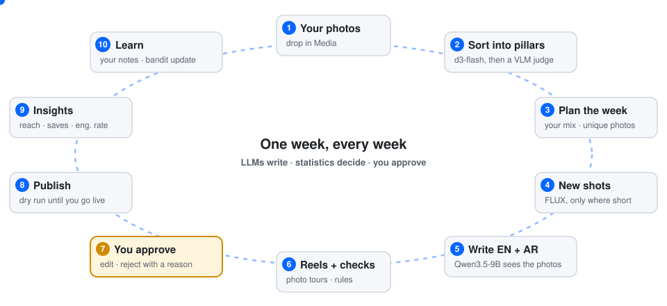</p>

<p align="center">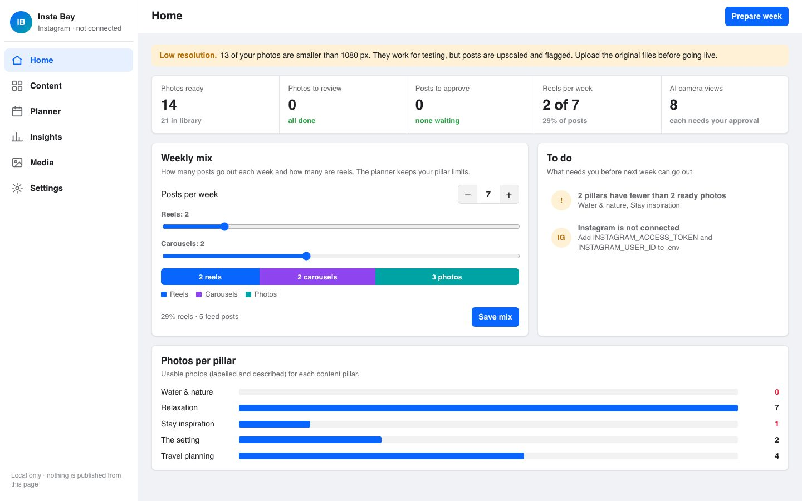</p>

**Contents:**
[What it does](#what-it-does) ·
[Screenshots](#screenshots) ·
[Architecture](#architecture) ·
[How each part works](#how-each-part-works) ·
[Why SQLite](#why-sqlite) ·
[Measured results](#measured-results) ·
[Challenges we hit](#challenges-we-hit-and-how-they-were-solved) ·
[Run it](#run-it) ·
[Repository map](#repository-map) ·
[Quality gates](#quality-gates) ·
[Future improvements](#future-improvements) ·
[Benchmarks](#benchmarks)

---

## What it does

1. **You drop in photos** of the resort. You can write descriptions, but you don't have to.
2. **Each photo is sorted into a content pillar** (Water & nature, Relaxation, Stay inspiration,
   The setting, Travel planning). A small vision model, `d3-flash`, does this first. When it
   isn't sure, a larger vision-language model (`Qwen3.5-9B`) looks at the photo and gives a
   pillar plus a one-line reason. Your corrections always win.
3. **The week is planned** with your chosen mix (for example 7 posts: 2 reels, 2 carousels and
   3 photos), inside each pillar's limits. Every photo is used **at most once a week**, and a post
   never shows the same spot twice.
4. **Missing photos become new shots.** When a post lacks photos of its pillar, FLUX.2 makes a
   new photograph of the same place from one or two of your photos. Shots that change the place
   or simply copy the source are dropped. Every kept shot is labelled as AI.
5. **A multimodal writer looks at the photos** and writes the brief, then native English and
   Arabic captions. It reads your past rejection reasons and caption edits as "avoid" and
   "prefer" notes.
6. **Reels are rendered**: a 15–18 second 1080×1920 "photo tour" with camera moves, or moving
   footage (Wan 2.2) when the photos are large enough.
7. **Checks run**: content rules, facility claims, repetition, small-photo warnings and the AI
   disclosure.
8. **You approve, edit or reject** in the studio. A rejection needs a reason; an approval
   doesn't.
9. **Publishing** is a dry run by default. Live Instagram needs a token, an explicit
   `--confirm-live`, and your stored approval of that exact content.
10. **Insights and learning**: real reach and saves (or the offline simulator's numbers, clearly
    labelled) feed a Thompson-sampling planner. Your rejections and edits feed the writers.

Two modes run the same pipeline:

<p align="center">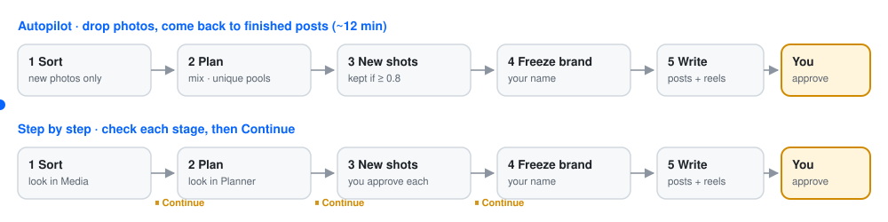</p>

---

## Screenshots

The studio is laid out like Meta Business Suite and runs only on your Mac, at `127.0.0.1:8780`.
The photos below are the owner's test photos (545×545 downloads). The Insights screen uses the
offline audience simulator and says so.

| Media library | Selecting photos for bulk actions |
|---|---|
| 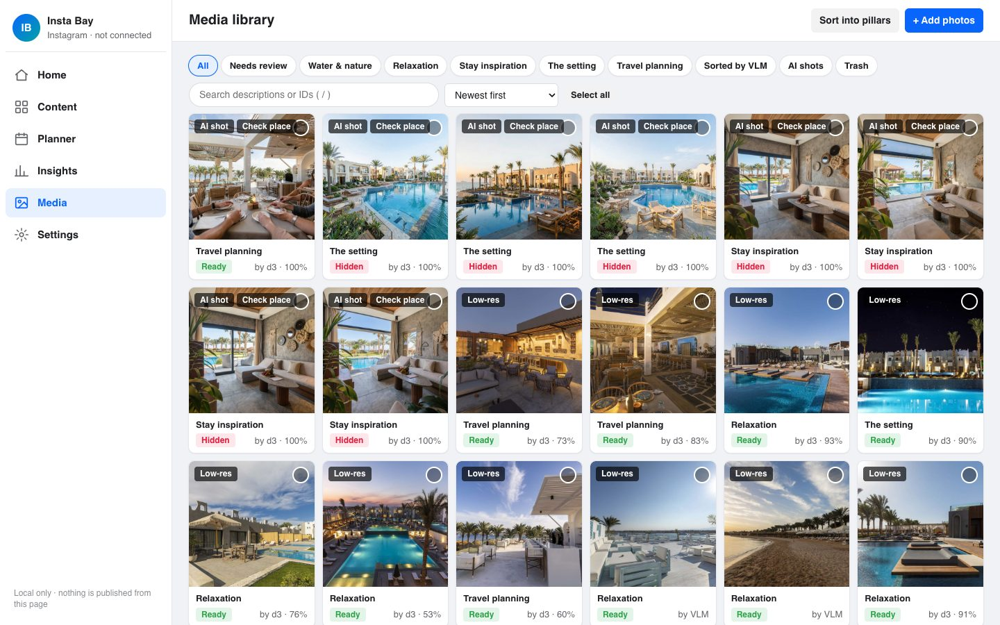 | 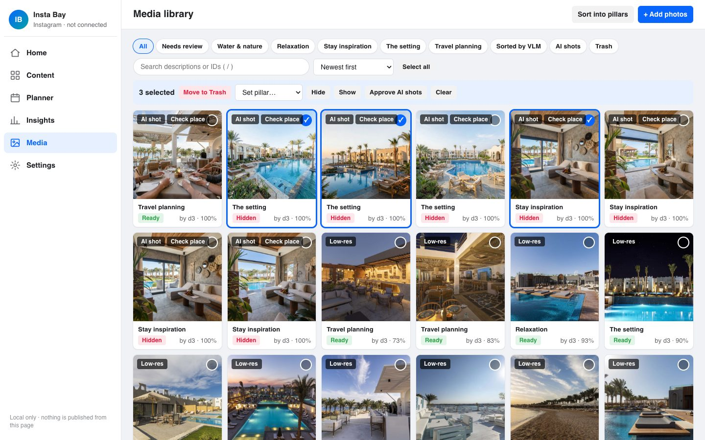 |
| **Photo details:** pillar, why it was chosen, download, sort again, trash | **Planner:** each day's post and the photos reserved for it |
| 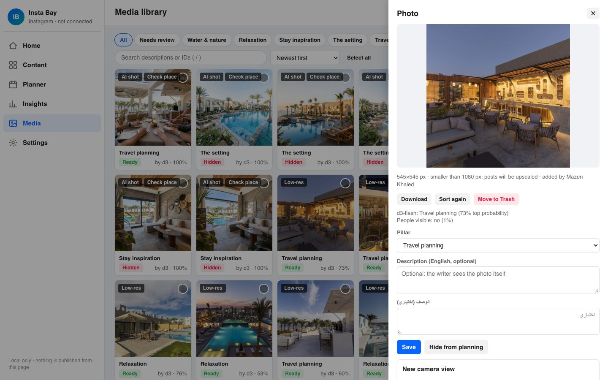 | 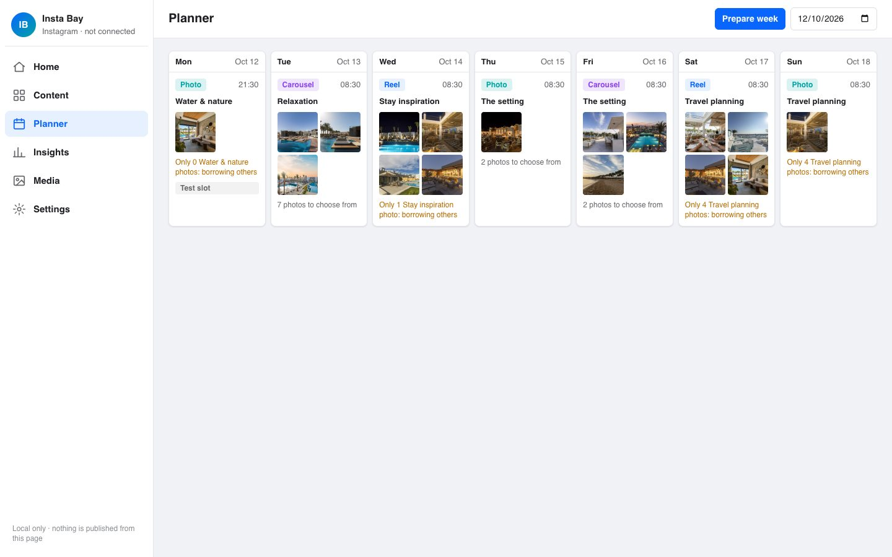 |
| **Content:** approve, reject, edit, undo, all in bulk | **A rendered reel**, with captions you can edit and copy |
| 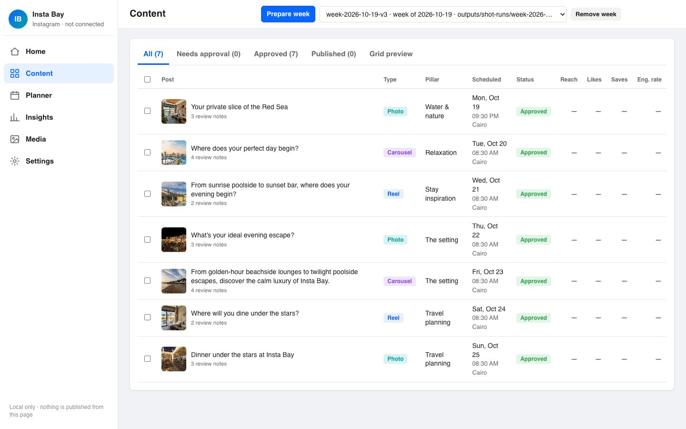 | 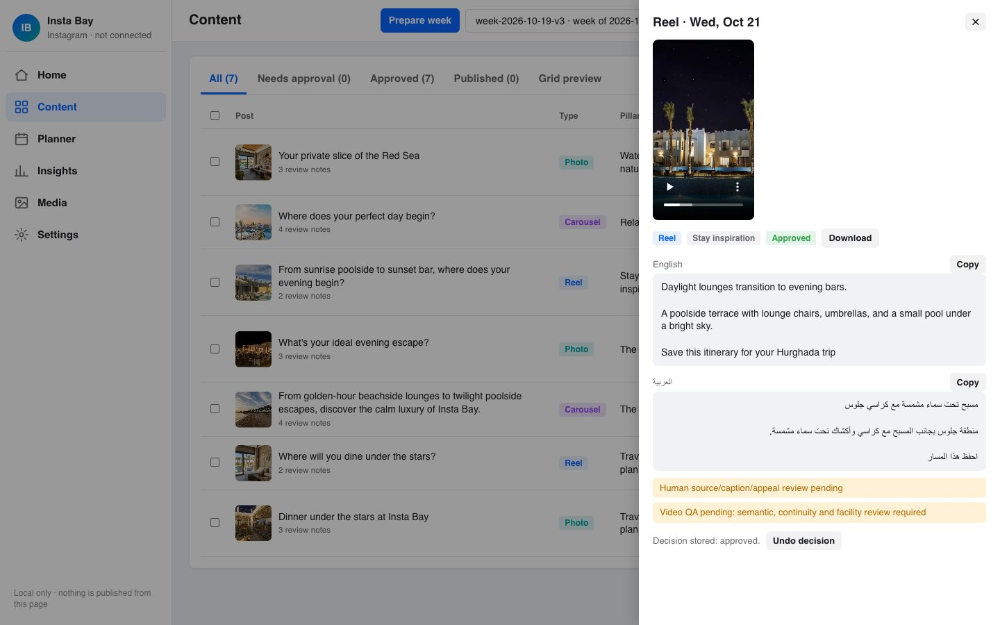 |
| **Grid preview:** the week as your Instagram profile | **Prepare week:** autopilot or step by step |
| 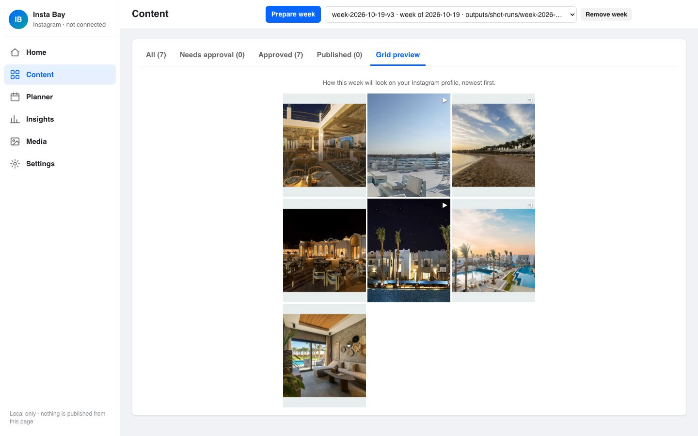 | 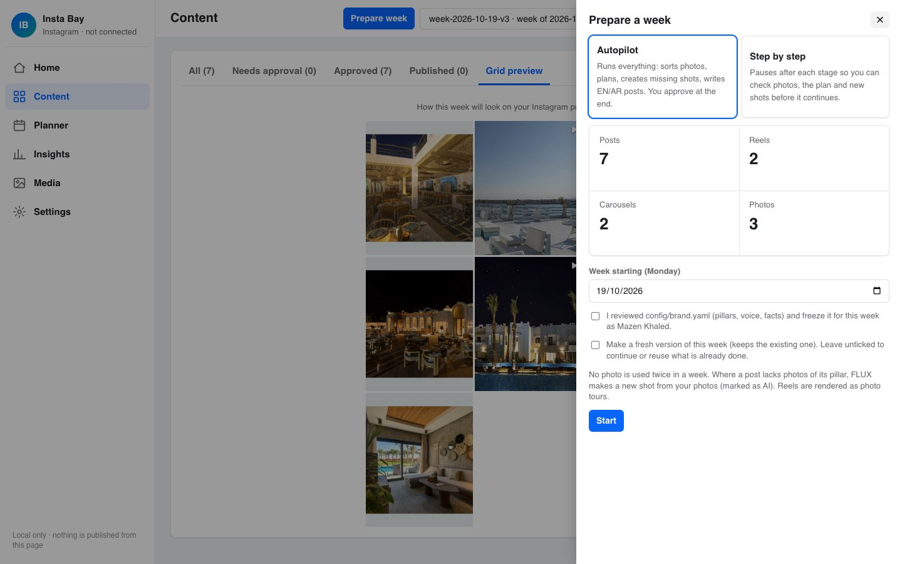 |
| **Insights** (simulated until Instagram is connected) | **Settings:** connections, what the writer learned, activity with undo |
| 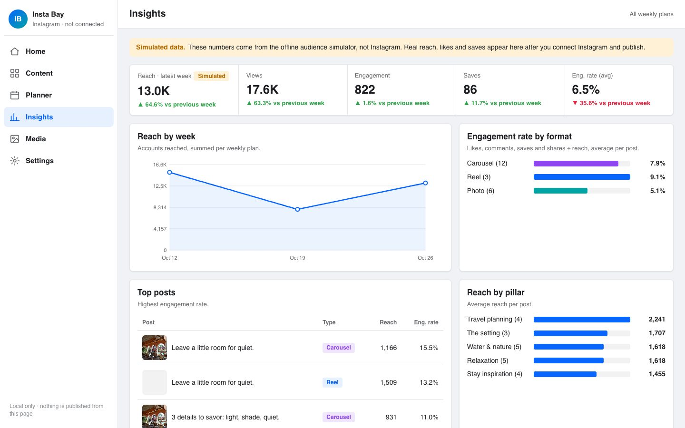 | 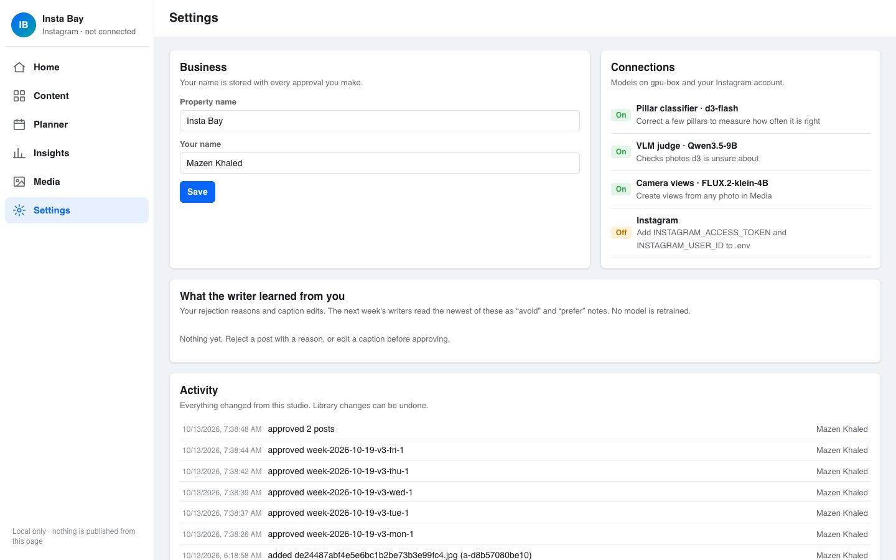 |

<p align="center">
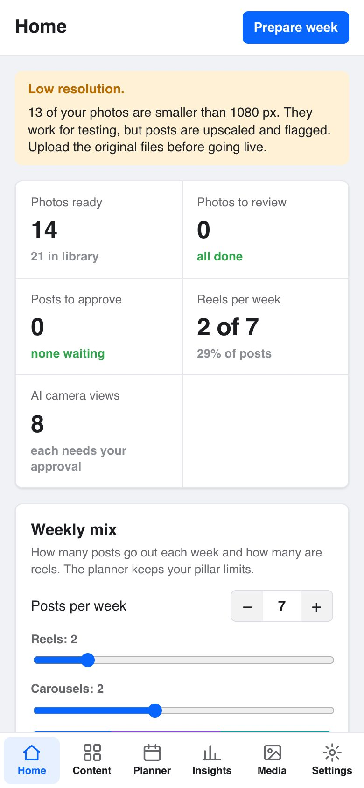
&nbsp;&nbsp;
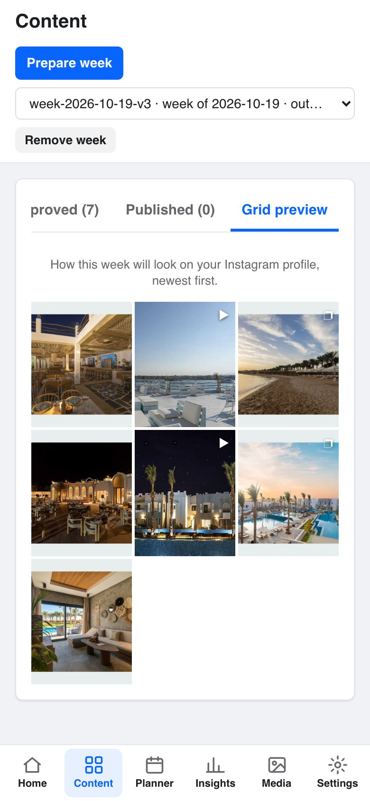
</p>

---

## Architecture

<p align="center">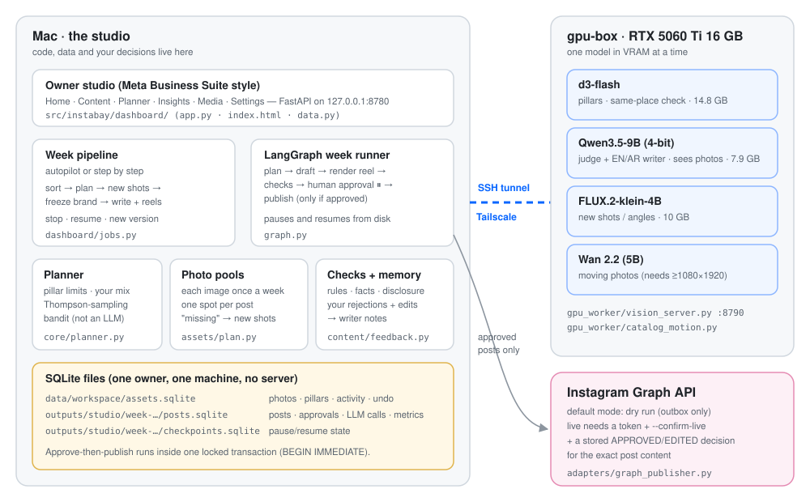</p>

**Two machines, one direction of trust.**

- **The Mac** holds the code, your data and every decision: the studio (FastAPI and one HTML
  page), the week pipeline, the LangGraph week runner, the planner and the SQLite files.
- **gpu-box** (RTX 5060 Ti, 16 GB, WSL Ubuntu) only runs models. It is reached over Tailscale
  through a dedicated SSH tunnel (`127.0.0.1:18790 → gpu-box:8790`). The studio reopens the
  tunnel by itself before any GPU action.
- **One model sits in VRAM at a time**; the service swaps them as needed:

| Model | Job | VRAM | Notes |
|---|---|---|---|
| `vllm-sr/d3-flash` | pillar probabilities; "same place?" check for AI shots | 14.8 GB | bf16; its 2 GB embedding table stays in CPU RAM so it fits 16 GB without quantization |
| `Qwen/Qwen3.5-9B` (NF4) | VLM judge, visual brief, EN/AR captions, reel direction | 7.9 GB | multimodal, so it sees the photos it writes about; pinned revision |
| `FLUX.2-klein-4B` | new shots and camera views from 1–2 owner photos | ≈10 GB | multi-reference image editing, ≈25 s per shot |
| `Wan 2.2 TI2V-5B` | moving photos for reels | ≈15 GB | needs full-size scenes (≥1080×1920 crop) |

**The design rule:** language models write and describe. Code and statistics decide what gets
planned, which photo goes where, whether a shot is kept and what gets published. You approve.

---

## How each part works

### 1. Photo sorting

<p align="center">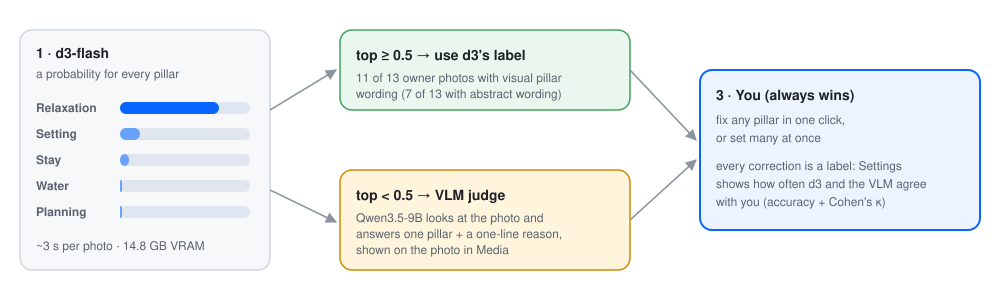</p>

- **d3-flash** answers a "choice" question whose options are the brand's own pillar descriptions,
  plus a "people visible?" question for consent checks.
- **Wording matters more than the model.** Describing what each pillar *looks like* raised d3's
  median confidence from 0.51 to 0.76 on the owner's photos (see [results](#measured-results)).
  That's why the brand template uses visual wording.
- **The judge runs after d3**, on all unsure photos at once, so the GPU swaps models only once.
- **Your corrections are labels.** Settings shows how often each model agrees with you
  (accuracy and Cohen's κ), so the models are measured, not trusted.

Code: [`assets/classify.py`](src/instabay/assets/classify.py), [`assets/judge.py`](src/instabay/assets/judge.py), [`decisions/vision.py`](src/instabay/decisions/vision.py).

### 2. Planning and photo pools

- **The planner** (`core/planner.py`) builds the week from your mix (posts, reels, carousels) and
  each pillar's minimum and maximum share. Over time a **Thompson-sampling bandit** learns which
  pillar, format, time and hook style work. The bandit is statistics, never an LLM.
- **Photo pools** (`assets/plan.py`) reserve images for each post before writing starts:
  - **unique:** an image is used at most once a week, and pools never overlap, so two posts
    can't pick the same photo;
  - **one spot per post:** a photo and every AI shot made from it count as one "family", and a
    post never holds two members of the same family;
  - **reuse is the last resort**, and it is reported;
  - **`missing`** counts how many images a post still needs *for its own pillar*. This tells
    autopilot where a new shot is needed.

### 3. New shots (FLUX.2)

<p align="center">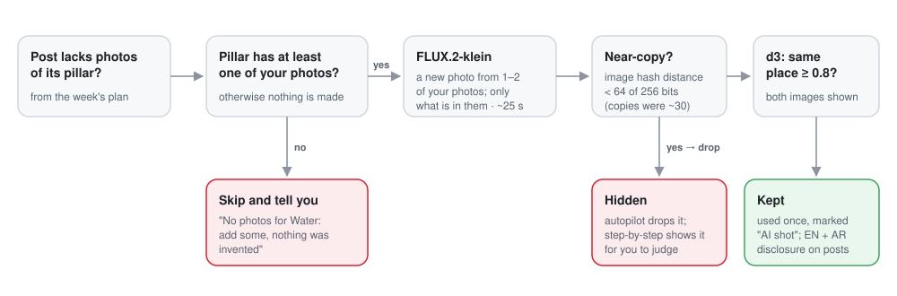</p>

The prompt asks for "a new photograph of the same resort, as if a photographer took another
picture there". It allows only buildings, pools, furniture and coastline that appear in the
reference photos. Every shot stores its full recipe and hash.

### 4. Writing

- **The visual brief writer** receives the reserved photos as images, together with the pillar
  goal and the angles already used this week. It chooses and orders the photos and writes the
  brief. For photos without your description, it writes a short **observation** in English and
  Arabic. That observation becomes the checkable fact the captions are built from.
- **The English and Arabic writers** each see the chosen photos and write natively, never
  translating each other.
- **Bookkeeping stays in code.** Model output only has to be creative: code fills the lead photo
  path, the fact IDs and any omitted lists. In real runs these bookkeeping fields caused most
  failures.
- **Feedback memory.** Your latest rejection reasons become "avoid" notes, and your caption edits
  become "prefer before → after" notes (newest 8 each). Settings lists them with **Forget**.
  No model is retrained.
- **Prompts** live in [`src/instabay/prompts/`](src/instabay/prompts); the Arabic prompts are
  written in Arabic. Every LLM call is logged with its prompt hash and can be recorded and
  replayed offline.

### 5. Reels

- **Photo tours** (any photo size): 4–5 different photos, each shown once, with push-in, pan and
  pull-out moves. Text appears only on the first and last shot, at most 8 words and 45
  characters. The reel lasts 15–18 s at 1080×1920, 30 fps.
- **Scenic motion** (photos at least 1080×1920): Wan 2.2 animates each scene on gpu-box, and the
  editor cuts the clips together.
- **The video director's rules run inside its own validation.** When a plan breaks a rule, the
  model is told exactly which shot and which limit, and gets up to 3 attempts.

### 6. Approval, publishing and safety

<p align="center">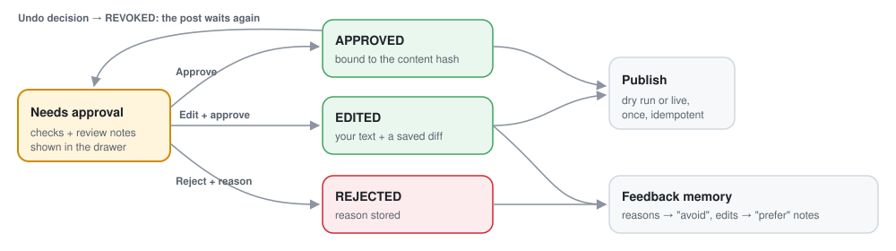</p>

- **Approvals are tied to the exact post.** An approval stores the hash of the post's content,
  so changing a caption or image invalidates it.
- **Decisions are append-only.** "Undo decision" adds a `REVOKED` record and never overwrites. A
  published post can't be un-approved.
- **Publishing:** dry run by default. Live mode needs Instagram credentials in `.env`, the
  `--confirm-live` flag and a stored approval. The publish step and its receipt are written in
  one locked SQLite transaction.
- **AI disclosure:** any post that contains AI footage or an AI shot carries the English and
  Arabic AI line (project rule 6).
- **Recipes:** every render stores its recipe and hash, so it can be cached and replayed.

### 7. The studio's everyday tools

- **Media:** select many photos; move them to Trash and restore them, or delete forever (photos
  used in a week are kept). Set the pillar in bulk; hide or show. Search (`/`) and sort. Download.
  Sort a photo again. Try another AI shot.
- **Undo:** every library change can be undone from the toast, with ⌘Z / Ctrl+Z, or from
  Settings → Activity.
- **Content:** edit captions before approving; undo a decision; approve, reject or undo in bulk;
  copy captions; download media; preview the grid.
- **Weeks:** stop a running week, continue it, make a fresh version, or remove a week to a backup
  folder.

---

## Why SQLite

| Reason | How the code uses it |
|---|---|
| One owner, one machine, no server | Nothing to install or keep running; a week is a file. |
| One database per week | `outputs/studio/week-…/posts.sqlite`: remove a week by moving a folder; tests run on copies. |
| Safe approvals | Approve-then-publish runs in one `BEGIN IMMEDIATE` transaction, so nothing changes between "is it approved?" and "publish". |
| Pause and resume | LangGraph checkpoints live in SQLite, so a week can stop for your approval, or after an error, and continue later. |
| Offline tests | All tests create throwaway database files; no server, no network. |
| Full history | LLM calls, cache, append-only decisions, metrics and the activity log sit next to the posts. |

**Its limit:** one writer at a time. To host the studio for a team that edits at the same time,
move to PostgreSQL. The tables use SQLModel, so that is mostly a connection change. It's on the
[improvements list](#future-improvements).

---

## Measured results

All numbers come from real runs on the owner's 13 photos (545×545) on gpu-box, unless marked as
tests. Details and dates are in [ADR 0013](docs/adr/0013-owner-asset-library-and-camera-views.md).

| What | Result |
|---|---|
| d3-flash load / VRAM | 13 s / 14.76 GB (embedding table in CPU RAM, no quantization) |
| d3-flash per photo | median ≈2.5 s, 0 failures on 8 photos |
| Pillar wording: abstract → visual | d3 median top probability **0.51 → 0.76**; confident labels **7 → 11 of 13** |
| VLM judge (Qwen3.5-9B NF4) | 13/13 answered, 2–5 s each; agrees with d3 on 10/13 |
| Full sorting cascade | 13 photos in 28 s (2 sent to the judge) |
| Qwen3.5-9B NF4 | 7.9 GB, 8.3 s load; brief ≈46 s, caption ≈17 s |
| FLUX new shot | 23–39 s, peak ≈10 GB |
| New shots kept | first run 0/8 (invented layouts, near-copies), after the policy fix 1/8 kept: a real new view of the rooftop bar |
| Same spot twice in one post | 0 of 7 posts |
| Autopilot week (7 posts incl. 2 reels) | ≈12 min end to end; reels 1080×1920, 15 s, 4 distinct photos each |
| AI views judged by eye vs d3 | good views scored 0.82–0.92, bad ones 0.45–0.72 (12 views, one rater) |
| Tests | **359 pass offline**; ruff and strict mypy clean |

**Not measured yet:** pillar accuracy against the owner's own labels (Settings will show it once
you correct some), caption quality as rated by humans, and real Instagram performance.

---

## Challenges we hit (and how they were solved)

Each challenge came from a real run, not a guess. The fix is in the commit history.

| # | Challenge | What we found | Fix |
|---|---|---|---|
| 1 | **d3-flash didn't fit the GPU** | 16.8 GB of bf16 weights on a 16 GB card; the model refuses dtype changes | the 2 GB token-embedding table runs in CPU RAM, so the numbers are exactly the same |
| 2 | **d3's "confidence" was misleading** | it ran below the top-option probability (0.2–0.37 vs 0.41–0.57) | use the top probability; keep every probability |
| 3 | **Pillars written for policy, not for pictures** | the old wording put almost every photo under "setting" | visual pillar descriptions: 7 → 11 confident of 13 |
| 4 | **Prompts were Maldives-only** | "a historical reference study of the Maldives property", "every photo is daylight" | rewrote them for the owner's own resort and for photos the writer can see |
| 5 | **The writer echoed the JSON schema** | Qwen3.5-9B returned the schema instead of an answer | the reply is prefilled with the first key, so the model must answer |
| 6 | **Bookkeeping fields failed whole weeks** | wrong lead-photo path, empty `fact_ids`, missing `must_not`, an over-long ignored field | code fills or ignores bookkeeping; the model only writes |
| 7 | **Pools offered too many photos** | a 5-photo reel was offered 6, so it picked 6 and failed twice | pools are capped at the format maximum |
| 8 | **FLUX invented places** | a "water" shot built from room photos added an infinity pool | no shots for pillars without photos; you're told to add some |
| 9 | **FLUX copied its source** | single-photo shots were near-identical (hash distance ≈30 of 256) | near-copies (< 64) are dropped |
| 10 | **d3 misjudged "photoreal"** | clearly real shots scored 0.45–0.59 | keep shots on the "same place" score only; photoreal is shown, not used |
| 11 | **Small photos blocked posts and reels** | 545×545 photos failed the feed size and Wan's 1080×1920 crop | upscale with a visible warning; reels become photo tours |
| 12 | **The editor's rules were written for motion footage** | 6-shot minimum, "open with movement", fixed 18 s, text on every shot | a photo-tour rule set: 4–5 unique photos, camera moves, text first and last, 15–18 s |
| 13 | **The director couldn't fix what it couldn't see** | retries got only "value_error", one problem at a time | our own rule messages, all problems at once, 3 attempts |
| 14 | **The image service "disappeared"** | the tunnel rode on SSH's shared connection, which closes after 10 idle minutes | dedicated tunnel with keepalive; the studio reopens it before GPU work |
| 15 | **AI shots and reels** | approved AI images were still treated as "reference only" in videos | an explicit owner-approved scope for AI shots, plus the AI disclosure |
| 16 | **A long credit line failed a reel** | an AI shot's "author" was the model name, so the credit passed 100 characters | the credit names photographers only and is shortened if needed |
| 17 | **Every week said "demo"** | `SELECT *` read the brand hash where the demo flag should be | named columns, plus a test |
| 18 | **One shared GPU, four models** | models fight for 16 GB | one resident model; stages ordered so it swaps once per batch |

---

## Run it

Full step-by-step guide: [docs/TEST_RUN.md](docs/TEST_RUN.md).

```sh
make setup                                           # once: dependencies + hooks
cp config/insta-bay-brand.example.yaml config/brand.yaml   # once: then edit your brand
make vision-up                                       # gpu-box models + tunnel
make studio                                          # http://127.0.0.1:8780
```

1. **Settings**: enter your name.
2. **Media → + Add photos**, tick **Autopilot**, then **Upload**. Or click **Prepare week** and
   choose **Step by step**.
3. **Content**: approve, edit or reject (a reason is needed only to reject).
4. When you're done: `make vision-down` frees the GPU.

Everything runs in dry-run mode. To go live, see [docs/GO_LIVE.md](docs/GO_LIVE.md).

<details>
<summary>Other commands</summary>

```sh
make check        # ruff + format + strict mypy + all offline tests
make demo         # one simulated week with canned responses; stops at approval
make bench        # benchmark harness → bench/results.json + the table below
instabay assets --help                 # the library from the terminal
instabay cycle --weeks 3 --db outputs/studio/sim/posts.sqlite \
  --checkpoints outputs/studio/sim/checkpoints.sqlite --outbox outputs/studio/sim/outbox
```
</details>

---

## Repository map

```text
src/instabay/
  dashboard/      the studio: FastAPI app, single-page UI, week pipeline (jobs.py), run data
  assets/         photo library, sorting cascade, photo pools, AI shots, export to the writers
  agents/         visual brief, EN/AR writers, judge, video director
  content/        evidence and observations, feedback memory, photo layouts, generation
  core/           planner, Thompson-sampling optimizer, rules, schemas, render recipes
  decisions/      d3-flash/System One clients, calibration, cascade
  video/          video studio, direction (photo tours / scenic), editorial assembly, QA
  adapters/       LLM clients and cassettes, Instagram Graph publisher and insights
  prompts/        every prompt as Markdown (Arabic prompts in Arabic)
gpu_worker/       vision_server.py (d3-flash, Qwen3.5-9B, FLUX), Wan motion jobs
sim/              frozen audience simulator (committed before the optimizer)
tests/            unit, integration, contract and determinism tests (offline)
docs/             architecture, ADRs, go-live, test run, research, samples
```

Deeper reading: [architecture](docs/ARCHITECTURE.md) · [decisions (ADRs)](docs/adr/README.md) ·
[research](docs/RESEARCH.md) · [go-live](docs/GO_LIVE.md) · [Instagram](docs/INSTAGRAM.md) ·
[production generation](docs/PRODUCTION_GENERATION.md) · [backlog](docs/BACKLOG.md) ·
[spec](docs/SPEC.md).

---

## Quality gates

- **Offline tests:** 359 tests run with no network, API keys or GPU. They use canned fixtures, a
  fake decision engine, a stub video backend and recorded LLM cassettes.
- **Strict typing:** `ruff check`, `ruff format --check` and strict `mypy` on `src/`, `sim/`,
  `config/` and `gpu_worker/`.
- **Pre-commit hooks:** the same checks, plus secret detection, run on every commit.
- **Browser checks:** every UI change was checked in real Chrome at 1440×900 and 390×844 (no
  console errors, no sideways overflow, data present, interactions exercised).
- **Real-GPU runs** are recorded in the ADRs with their numbers and limits.
- **Hard rules** (from the project spec): no publish without a stored approval; dry run by
  default; secrets only in `.env`; every render has a recipe and hash; AI imagery is always
  disclosed; the simulator was committed before the optimizer.

---

## Future improvements

Planned next steps, roughly in order of value:

1. **Connect Instagram.** Add the token in `.env`, publish approved posts, and pull real insights
   into the Insights screen and the planner's learning.
2. **Owner labels → measured accuracy.** Correct about 30 photo pillars to measure d3 and the
   judge, then tune the 0.5 confidence and 0.8 shot thresholds from data.
3. **Preference learning.** Use approve/reject rates per pillar, format and hook as a planner
   signal before Instagram data exists.
4. **Fine-tune the writer (LoRA).** After roughly 200–500 approved or edited captions, train on
   gpu-box overnight, especially for Arabic quality.
5. **Better Arabic.** Compare Qwen3.5-4B (bf16) with 9B (NF4); add an Arabic-native reviewer
   step.
6. **Sound for reels.** Add a soundtrack or licensed music library, plus beat-matched cuts.
7. **Real motion from small photos.** Upscale before Wan, or film short clips on site.
8. **Better new shots.** Measure Qwen-Image-Edit's multi-angle mode against FLUX.2-klein on the
   same photos.
9. **Planner drag and drop.** Move posts between days and times; regenerate a single post.
10. **Scheduled autopilot.** For example every Sunday night, with a notification when posts are
    ready.
11. **Comments inbox.** Suggested English and Arabic replies, once Instagram is connected.
12. **Team hosting.** PostgreSQL, logins and roles, a proper job queue, and backups.
13. **Exports.** A week as a PDF or ZIP for review; caption and hashtag templates.

---

## Benchmarks

Run `make bench` for all five metric rows, the policy comparisons and the generated results
table. The offline command writes `bench/results.json`, intermediate evidence and blinded rating
templates under `outputs/bench/`. It never approves or publishes drafts. The results below come
from canned quality fixtures and the unchanged synthetic audience; human ratings and real model
quality are still pending.

<!-- BENCHMARK:START -->
| Metric | Result (95% interval where shown) | Evidence / limitation |
|---|---|---|
| Brand consistency | 4.60 [4.60, 4.60] / 5; hard rules 100.00% [100.00, 100.00] | Canned judge, κ pending human labels; (0/20 posts); control 2.20 [2.20, 2.20] / 5 |
| Arabic quality | Human native: Pending human ratings; MT: pending; native win: pending | Canned judge 4.67 [4.67, 4.67] / 5; 0/20 human pairs; interval alpha undefined/pending; authored MT fixtures; no real-model quality claim |
| Optimization uplift | 68.20% [37.77, 114.14] | Synthetic Thompson vs fixed week-1; weeks 9-12; 20 paired seeds |
| Efficiency | feed: 1080 in/490 out tokens; local p50/p95 6.79/7.33 ms; actual $0.0000/post; paid pending; reel_concept: 1080 in/490 out tokens; local p50/p95 6.87/7.71 ms; actual $0.0000/post; paid pending | Fixture tokens/local timing; 0 video renders |
| Autonomy | Pending human timing; configured automation 87.5%; first-pass approval pending | Topology only; full pipeline measurement pending approval; bench never publishes |

Policy comparison (synthetic audience; seed-cluster intervals):

| Policy | Weeks 9-12 engagement rate | Cumulative expected regret | Leaked / learned posts |
|---|---|---|---|
| fixed | 4.85% [3.63, 6.19] | 4.69 [3.72, 5.81] | 0 / 0 |
| uniform | 4.92% [4.26, 5.64] | 4.53 [3.70, 5.42] | 0 / 0 |
| thompson | 8.15% [7.06, 9.23] | 2.66 [2.22, 3.17] | 0 / 1680 |
| oracle | 10.43% [9.20, 11.75] | 0.00 [0.00, 0.00] | 0 / 0 |
| leak_unguarded | 7.83% [6.69, 8.92] | 2.87 [2.40, 3.41] | 301 / 1680 |
| leak_guarded | 7.78% [6.66, 8.87] | 2.95 [2.45, 3.53] | 301 / 1379 |

Synthetic D1-on minus D1-off regret: 0.08 [-0.04, 0.21]. Negative favors the guard; an interval crossing zero does not establish a difference.

Generated from [bench/results.json](bench/results.json). [Protocol, rubric and HUMAN steps](bench/README.md). Canned rubric/control scores test the harness; they do not establish real judge accuracy.
<!-- BENCHMARK:END -->

---

<sub>Built on a Mac plus a 16 GB RTX 5060 Ti. Photos in the screenshots are the owner's test
photos. The audience in Insights is simulated until Instagram is connected.</sub>
