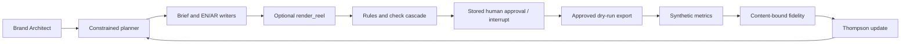
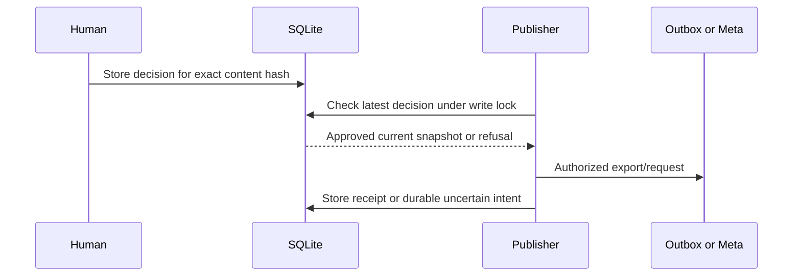

# Architecture

Insta Bay is an approval-first bilingual marketing prototype for a fictional Hurghada resort.
Python 3.12, Pydantic boundaries, SQLite and LangGraph implement an offline weekly loop.
LLMs produce content; code plans and learns; a human authorizes exact snapshots. The default
runtime uses `FakeLLM`, concept-only reels and `DryRunPublisher`. No production LLM client,
end-to-end live campaign or native GPU quality result is implemented/verified.

## Weekly execution

`graph.py:WeekRunner` wires brand → plan → draft → render_reel → checks → human_approval →
publish. The render node is a no-op unless a render service is supplied. `cycle.py:CycleRunner`
wraps complete approved weeks with synthetic insights, analysis and the next constrained plan.
The diagram's learning loop describes that synthetic cycle; native Graph insight ingestion
stores raw observations without bandit updates.

The planner enforces integer pillar bounds, cadence, at least one reel, Cairo posting windows,
quiet hours and an exploration slot. The optimizer samples factor-level Beta beliefs with a
seed keyed to week/factor/level. It does not use an LLM. The simulator was frozen in `29fed9c`
before optimizer commit `98c9202`; its hidden logits are unavailable to the production planner.
Only the benchmark oracle reads them, to measure regret against its declared feasible family.

## Boundaries and modules

| Area | Implementation | Evidence / current boundary |
|---|---|---|
| Typed domain | `core/schemas.py`, `core/tables.py` | Validated brand, slot, post, approval and API/media boundaries; UTC DB times, Cairo schedules. |
| Content | `agents/`, `prompts/`, `llm.py` | Shared brief, independent EN/AR calls, hashed Markdown prompts, schema validation and one invalid-output retry. |
| External LLM | `adapters/llm.py:LLMClient`, `fake_llm.py` | Fixture implementation only; exact unknown keys fail. Production provider/recording is pending. |
| Orchestration | `graph.py`, `cycle.py` | Durable checkpoint IDs and restart-safe human interrupt; default generation remains fixture-only. |
| Content checks | `core/rules.py`, `agents/judge.py`, `decisions/cascade.py` | Rules first, optional calibrated atomic decisions, judge fallback, at most one caption revision. |
| Decision engines | `decisions/engine.py`, `jev_http.py`, `laya_local.py` | Exact-input fake, opt-in HTTP/local interfaces; native calibration/accuracy remain unmeasured. |
| Approval/storage | `repository.py`, `approval.py` | Append-only decisions, timed edits/reasons, exact current hash and latest decision required. |
| Publishing | `adapters/publisher.py`, `graph_publisher.py` | Atomic dry-run intents; explicit guarded native adapter for prepared non-demo media. |
| Insights/learning | `adapters/graph_insights.py`, `core/learning.py`, `core/optimizer.py` | Missing real values remain missing; live reward normalization/learning is blocked. |
| Video | `core/recipe.py`, `video/`, `gpu_worker/` | Verified L0 cache, actual CPU MP4 tests, private queue; Wan/Comfy code is human-only and unverified. |
| Evaluation | `benchmarks/`, `bench/`, `tests/` | Frozen synthetic comparisons, blinded human packets, grouped intervals and offline contracts. |

These are explicit Python agents and workflow nodes, not a deployed autonomous agent service.
Optional native engines/backends are lazy and opt-in; installing the normal project does not
install torch, download model weights or start the GPU worker.

## Persistence and authorization

A post hash includes bilingual copy, hashtags, prompt hashes, brand/slot identity, optional
public media manifest and optional local render recipe/preview hashes. Changing these fields
invalidates old approvals. The latest stored decision must be `APPROVED` or `EDITED` and match
that hash. A graph `Command(resume=...)` cannot manufacture an approval. Human rejections skip
publishing; flagged content needs an explicit reason, never automatic acceptance.

SQLite business state contains brands, arms/slots, posts/tags, reviews and judge/decision evidence,
approvals, publications, long-format metrics, scoped posteriors, learning receipts and render jobs.
A separate SQLite checkpoint file stores workflow position. Nullable migrations preserve older
post hashes when optional media/cascade/render evidence is absent. LLM cache/call records share
the business database. Synthetic metrics, fidelity receipt and four belief changes commit together;
retries cannot learn twice. Published snapshots and active/uncertain Graph operations are frozen.

Dry-run export holds a SQLite write transaction across authorization, atomic file write and
receipt. Native publishing journals create/publish intent before each POST and stores accepted
IDs before the next step; every operation rechecks approval. This provides safe local retry
semantics. It does not prove remote exactly-once delivery after an ambiguous response. An
unknown POST outcome holds the journal for human reconciliation instead of blind resubmission.

## Model and render evidence

LLM cache keys include prompt bytes/hash, inputs, slot, schema, model and generation settings.
Only valid output inside the measured budget is cached. The ledger stores usage/times and safe
error categories, without raw provider errors or credentials. Per-run usage survives restarts.
Three separately keyed judge samples exercise the rubric, but canned samples are not evidence
of model independence, quality or calibration.

Decision profiles bind brand, engine revision, language, question hash and dataset hash. Bilingual
counterparts and duplicate states stay in one 60/20/20 group split. Validation fits the scalar
confidence correction and retention threshold; held-out test can disable a cell, never retune it.
Synthetic profiles cannot enable native fast paths. D1 needs calibrated bilingual semantic
consensus; missing/mismatched evidence cannot teach the optimizer. D3 uncertainty holds untrusted
text before future prompt insertion; D4/D5 deployment and learned queue ranking remain pending.

A complete render recipe records still/model/font/audio/workflow hashes, prompts, scheduler and
motion/post settings, seeds, runtime identity and declared native pins. `renders/{recipe_hash}`
stores recipe, MP4, result, frame hashes and contact sheet. Verified cache hits reuse bytes;
changed media or QA metadata is refused. Actual ffprobe checks run before completion. Missing
DINO/vision/seam/property evidence keeps `needs_review`. Native uncertain jobs stay held.
All generated-footage posts require EN/AR disclosure; generated facilities are forbidden.
Historical Grand Resort photographs are reference-only and do not verify Insta Bay amenities.

## Operational scope

The CPU runtime image runs as UID 10001 with state under `/state`; validation uses a separate
image containing dev tools and fresh-clone Git metadata. Both run acceptance with networking
disabled. Dependency installation occurs during image preparation, not during offline tests.
The GPU service is intended for a private Tailscale address with ACLs and a header token; it is
not deployed. No token or environment file is bundled into either image.

See [research](RESEARCH.md), [go-live prerequisites](GO_LIVE.md), [decision details](DECISIONS.md),
[video limits](VIDEO.md), [Graph retry semantics](INSTAGRAM.md), and the [ADR index](adr/README.md).
