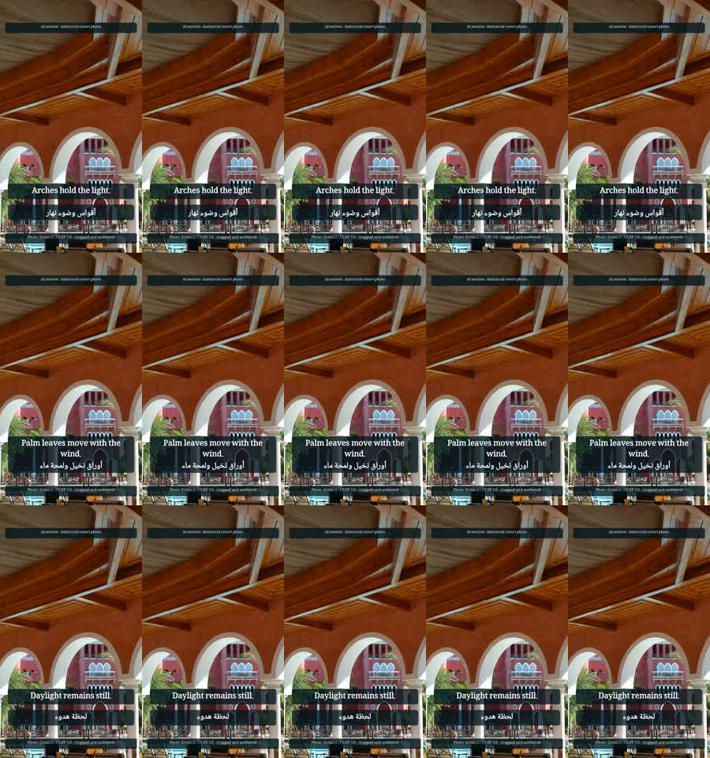

# Real generation and resort preview

This optional experiment generates actual model responses and conditions video on an approved
crop of a historical photograph of **The Grand Resort Hurghada**. It is an unpublished reference
for fictional Insta Bay. Current facilities, affiliation and promotional offers are not inferred
from the image. The original photos and their manifest remain unchanged.

## Local text generation

Qwen/Qwen3-4B-Instruct-2507 is pinned at
`cdbee75f17c01a7cc42f958dc650907174af0554`. The standalone server loads only cached local weights,
serializes requests and reports actual token counts. Keep it bound to the GPU loopback interface.
SSH authentication protects the tunnel; there is no publicly exposed HTTP service.

```sh
ssh gpu-box 'mkdir -p ~/instabay-native/data ~/instabay-native/outputs'
rsync -av gpu_worker/local_llm_server.py gpu-box:instabay-native/
ssh gpu-box 'cd ~/instabay-native && INSTABAY_LLM_ENABLED=1 ~/miniconda3/envs/main/bin/python -m uvicorn local_llm_server:app --host 127.0.0.1 --port 8765'
# In another terminal:
ssh -N -L 18765:127.0.0.1:8765 gpu-box
INSTABAY_LLM_ENABLED=1 instabay generate-preview \
  --model Qwen/Qwen3-4B-Instruct-2507@cdbee75f17c01a7cc42f958dc650907174af0554 \
  --confirm-generation
```

The command uses English/bilingual and Arabic-native prompt stages, validates outputs, logs
latency and tokens, and caches by actual model revision, prompt hash, schema and inputs. Unknown
provider errors never select fixtures. `copy.json` is the raw composed model output;
`generation.json` lists the exact stage records. Arabic was awkward in this observed run.
`scripts/build_resort_preview.py` preserves it and explicitly records editorial corrections in
`copy.edited.json` and `editorial-edits.json`. There is no automatic judge-quality claim.
The workflow also accepts an injected `LLMClient`; ordinary CLI demos still use FakeLLM.

## Approved photo baseline

```sh
python scripts/build_resort_preview.py
```

This requires a preceding generation run. It crops the unchanged source at x=1440, y=0,
width=1296, height=2304 and resizes to 576x1024. `crop-approval.json` records the original and
derived hashes, the user's crop approval, source and license. That approval applies only to
this unpublished preview. The script uses three 5-second camera moves, bilingual overlays,
photographer credit and an explicit photo-preview label. The source is credited to Ercan.G,
[CC BY 3.0](https://creativecommons.org/licenses/by/3.0/), cropped and animated; see the
[original Commons page](https://commons.wikimedia.org/wiki/File:Hotel_Grand_Resort_-_panoramio.jpg).

Outputs are local, ignored files in `outputs/resort-preview/`: MP4, contact sheet, captions,
recipes, hashes and SQLite render/call ledgers. No preview grants publishing permission.

## GPU experiment

The [official Wan checkpoint](https://huggingface.co/Wan-AI/Wan2.2-TI2V-5B-Diffusers) is pinned
at `b8fff7315c768468a5333511427288870b2e9635`. Download it directly on gpu-box with
`scripts/download_wan_preview.py`; it hashes every downloaded model/config file. The prepared
conda environment supplies Torch 2.10.0+cu128. This experiment installed Diffusers 0.37.1 and
imageio-ffmpeg 0.6.0, without replacing Torch.

```sh
rsync -av scripts/download_wan_preview.py gpu-box:instabay-native/
ssh gpu-box 'cd ~/instabay-native && ~/miniconda3/envs/main/bin/python -u download_wan_preview.py'
```

Only one heavy model runs at a time: stop the local Qwen service before Wan. Transfer the crop,
worker and a JSON `PreviewSpec`, then run the standalone worker in tmux:

```sh
rsync -av gpu_worker/wan_preview.py gpu_worker/run_preview.sh gpu-box:instabay-native/
rsync -av outputs/resort-preview/keyframes/day-arch.jpg gpu-box:instabay-native/data/
rsync -av outputs/resort-preview/wan-spec.json gpu-box:instabay-native/outputs/
ssh gpu-box 'tmux new-session -d -s instabay-wan-render "cd ~/instabay-native && sh run_preview.sh outputs/wan-spec.json > outputs/wan-render.log 2>&1"'
rsync -av gpu-box:instabay-native/outputs/wan-motion/ outputs/resort-preview/wan-motion/
python scripts/build_resort_preview.py --motion outputs/resort-preview/wan-motion/RECIPE_HASH
```

For a one-clip experiment, add `--repeat-single-clip`: the same five-second generated clip is
used in three text variants to make a 15-second layout preview. Captions explicitly record
`unique_motion_clips=1` and `source_clip_reused=true`; this is not three independent renders.

The motion recipe is written **before inference**. It includes image hash, pinned model weights,
I2V pipeline identity, expanded timestep conditioning, scheduler, seeds, resolution, frame count,
steps, guidance, actual runtime packages and worker hash. The worker refuses to overwrite an
existing attempt, writes progress per shot, checks finite prompt embeddings, and retains its
source alongside each new trial. Frames are conditioned on the photograph, not generated from
text alone. The preview worker is an experiment; the production native adapter remains guarded
by its existing exact runtime and Docker requirements.

Recorded-motion imports verify original recipe/hash, crop conditioning and clip bytes before
CPU post. A `stub` render-stage label denotes CPU post-processing, while
`post.recorded_motion.backend=wan` identifies the real generation. `ai_disclosure=true` and EN/AR
caption disclosure lines are retained. Generated video is never marked human-approved by the
crop approval. Final QA checks real H.264/yuv420p/1080x1920/30fps/AAC48kHz/15s/faststart output.
Uncalibrated semantic, continuity and property-fidelity review remains pending; distorted trials
must not be used for marketing. Exact observed results are recorded separately after review.

## Observed output, 2026-10-12

[Download the actual 15-second MP4](samples/resort-ai-motion.mp4), compare the
[approved crop](samples/resort-approved-crop.jpg), and inspect the
[raw model copy](samples/resort-copy.raw.json), [edited copy](samples/resort-copy.edited.json)
and [captions/disclosures](samples/resort-ai-motion-captions.json).



| Measurement | Observed result |
|---|---|
| Real Qwen generations | 4 successful calls, 3,242 total successful-call tokens |
| Working Wan settings | 576x1024, 61 frames at 12fps, 40 steps, CFG 5, shift 3, seed 1701 |
| Native generation time | 442.38 seconds including setup after checkpoint verification |
| Peak allocated CUDA memory | 14,767,928,320 bytes (13.75 GiB) |
| Final encoded video | 1080x1920, 30fps, 15 seconds, 450 decoded frames, 2,889,153 bytes |
| Source clip reuse | One five-second native clip repeated across three text variants |
| Automatic spec gate | Passed; semantic/continuity/property QA remains pending |
| Offline tests | 268 passed; strict types on 88 files; all hooks passed |
| API fees | $0 locally; electricity/hardware costs were not measured |

The first 288x512/20-step trial rendered but showed neon colours and distorted arches. A
576x1024 trial then ran out of memory: calling the encoder outside inference mode retained its
autograd graph. After fixing that, the same larger settings completed. Opening/middle/final
frames showed natural colours and recognisable source geometry; this limited visual inspection
does not establish full fidelity. Motion is very subtle, so the preview chiefly demonstrates
conditioning, copy, disclosure and layout. It is not a finished varied-shot campaign or a new
calibrated benchmark result. There is no post approval or publication.

The [machine-written evidence](samples/native-preview-evidence.json) links actual call records,
timings, QA, artifact hashes and earlier failures. The
[native recipe](samples/wan-motion-recipe.json), [native result](samples/wan-motion-result.json)
and [CPU post recipe](samples/resort-post-recipe.json) preserve provenance. Their paths describe
the measured local run; reconstruct equivalent files under those relative paths before cache
replay. Crop/source/license and editorial changes are retained in the accompanying JSON files.
