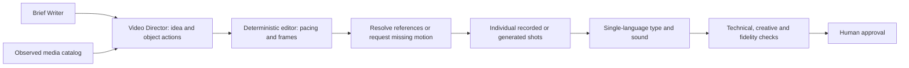

# Brief-led Video Director

The video brief should become a small film: one idea, a visible opening action, details that build toward a reveal, and the brief's closing request. A photograph is evidence for a shot, not the entire story. The previous preview repeated one generated clip and displayed bilingual panels throughout; it had no audio track carrying a score. The new director separates the story, evidence, movement and edit.



The user supplies the brief and approved media. They do not choose first/last frames, interpolate endpoints or sequence keyframes. Image conditioning stays internal because generated resort footage must retain photographed evidence. Legacy recipe rendering remains available for compatibility; `direct-video` is the new brief-led entry point.

## What makes this edit work

The director identifies a viewer payoff and explains how each selected object serves a field in the brief. For the calm courtyard brief, flowers introduce movement, water and palms build texture, arches reveal the setting, and the closing question invites a save. Each action must be allowed by the observed object catalog. Architecture cannot be given an invented water effect. Missing facilities or footage block a finished render; a photo-only animatic requires an explicit flag.

Hook → body → close and purposeful sound are supported by [TikTok Creative Codes](https://ads.tiktok.com/business/en-US/creative-codes) and Google's [ABCD creative guidance](https://support.google.com/google-ads/answer/14783551?hl=en-AU-u-fw-mon-mu-celsius). They guide this experiment; they do not establish Instagram retention gains. Our 18-second duration, first cut within two seconds, three-subject minimum and sparse text limits are editable engineering presets, not universal laws of appealing video.

The LLM chooses meaning and pacing words; code computes exact 30 fps frame counts. One native director experiment failed on arithmetic four times before this separation. Native output is preserved separately from editorial corrections. Sparse overlays use white unboxed type, with separate English and Arabic exports and brief fades. An original deterministic score cues the actual cuts. It uses synthesized tones and no external samples; it is not a recording of resort ambience.

## Evidence and motion

`config/resort-objects.yaml` records observed objects, crop approval, source-byte hashes and author/license links. It currently covers historical photographs of one real property, The Grand Resort, Hurghada. These support a reference preview, not a claim about present facilities or an endorsement. Several palm/building details come from small crops and cannot supply the detail of proper filmed B-roll.

Prefer licensed real B-roll when available. Otherwise generate only actions appropriate to the reference: existing leaves sway or photographed water ripples. Motion prompts come from stored templates plus observed descriptions, rather than passing invented LLM details directly to the model. Generated clips need their own stored recipe, matching conditioning hash, AI disclosure and reference-only status. Crop approval does not approve a generated clip or a post.

The opening flower shot and later water shot are separate native Wan renders. Other shots use camera edits of real photographs. This remains a mixed-media prototype: camera movement on a photograph is not physical scene movement. The preview is not a substitute for new on-location footage.

Clip intervals are selected automatically using sustained source-frame changes; ties prefer less static material. This detects frozen footage, not attractive motion or fidelity. Every clip, interval, font, board and audio file is hash-bound in a recipe stored before assembly. Directed boards and derived media are content addressed. The editor preserves exactly timed fractional cuts when mixing 12 fps generated clips and 30 fps photo edits.

## Checks and limits

Creative checks reject unknown objects, unsupported actions, a still opening, repeated motion bytes, missing motion, long copy and a text wall. The report records shot variety, first cut, text coverage, audio presence and actual source-frame changes. It leaves appeal review pending and engagement lift unset. No LLM beauty score is trusted without human labels and calibration.

Technical checks still verify H.264, 1080×1920, constant 30 fps, AAC at 48 kHz, duration, size and faststart. Within-shot consistency matters for an intentional multi-object edit; a DINO similarity threshold across a flower-to-arch cut would penalize the desired story. Directed visual QA therefore additionally requires brief match and readable object actions. Semantics, fidelity and appeal remain `needs_review` without independent evidence. No preview approves or publishes a post.

## Run it

Plan with the offline fixture:

```sh
uv run instabay direct-video --brief path/to/brief.json
```

Native planning uses the existing opt-in local LLM adapter:

```sh
uv run instabay direct-video --brief path/to/brief.json \
  --model Qwen/Qwen3-4B-Instruct-2507 --confirm-generation
```

The output includes a bound board and motion requests. Add each reviewed local clip and its provenance to the catalog, then assemble both languages:

```sh
uv run instabay direct-video --brief path/to/brief.json \
  --board outputs/directed-resort/board.json \
  --catalog path/to/catalog-with-motion.yaml --render
```

For an explicitly unfinished photo edit, append `--animatic`. `WeekRunner(video_catalog=..., video_studio=...)` uses the director before checks and the existing approval interrupt. The weekly graph currently attaches the English edition; the standalone command exports both languages. Keep render roots writable. Tests and the normal demo remain offline.

## Next measurements

Ask humans to compare the old and new actual exports for first-second interest, coherent payoff, readable text, credible property appearance and desire to save. Do not call format compliance an audience win. With licensed contemporary video, compare B-roll-first against this mixed-media version using the same brief. Only approved, rights-cleared posts can later supply engagement data to the existing statistical optimizer.
